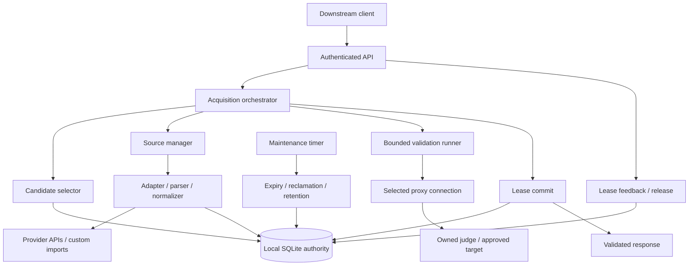

# Proxy Pool Architecture Specification

Version: 0.6. Status: vertical slice implemented (see README); later
milestones are still design-only.

Reference review date: 2026-10-31.

Deployment decision: Go, one application process, local SQLite, and no Redis.
The default target is a 2-core, 1-GiB Huawei Cloud Flexus L instance. See the
[low-memory deployment profile](deployment-go-lite.md) for implementation limits.
This replaces v0.1's PostgreSQL-first recommendation; domain and strict-delivery
contracts remain in force.

## 1. Goals and Boundaries

The system acquires proxy resources from multiple provider APIs and custom
imports, normalizes them into a common inventory, and validates a selected
resource only when a downstream client requests delivery.

The first implementation is a resource-distribution service, not a traffic
forwarding proxy. Clients receive connection details and use the proxy directly.

Normative words `MUST`, `MUST NOT`, and `SHOULD` define implementation contracts.
Numerical defaults are starting points to benchmark, not established SLOs.

### Mandatory invariants

1. Every returned item MUST have a successful validation attempt initiated for
   the current delivery request. A previous request's success MUST NOT bypass it.
2. Delivery authorization always requires a current-request validation.
   One nightly full validation pass is allowed only for self-uploaded custom
   sources (operator-scheduled, bounded, skip leased/cooldown resources) to
   refresh health and retire repeatedly dead proxies; it never creates leases
   or authorizes delivery. No periodic task may sweep provider-API inventory,
   and no timer may bypass invariant 1.
3. Validation MUST use the same connection, credential version, session context,
   and profile that the response describes. It MUST NOT fall back to direct I/O.
4. A resource MUST still be eligible when its lease is committed and when the
   response is dispatched. A validation pass does not override expiry,
   revocation, capacity limits, or a newer attributed failure.
5. A failed, timed-out, stale, or inconclusive validation MUST NOT be delivered.
   Return a partial result or an explicit error; never return an unchecked item.
6. A provider outage, judge outage, or target-specific rejection MUST NOT be
   treated as proof that every affected proxy endpoint is globally dead.
7. Concurrent allocation MUST be atomic in one authoritative datastore. Network
   validation MUST NOT hold a database transaction open.
8. An observed exit IP is not the identity of a proxy resource, and an endpoint
   address alone is not a complete authenticated connection identity.

Eligibility is evaluated at explicit reservation/commit/dispatch checkpoints.
The dispatch checkpoint is the final authoritative check immediately before a
buffered response is written. A later source revocation or network failure cannot
recall bytes already sent; this is not an atomic transaction with the client.

### Explicit limitations

- A pass proves that a particular probe succeeded at a particular time. It is
  not a guarantee of availability throughout the lease or business compatibility.
- A rotating gateway can pass a probe and use a different exit IP next time.
- A pool lease limits allocation by this service. With direct-client use, it
  cannot stop traffic after expiry, prevent credential copying, or measure the
  true number of open upstream connections.
- Hard traffic isolation, mandatory revocation, and guaranteed request routing
  require a forwarding data plane, which is outside the first version.
- Untrusted proxies MUST NOT be assumed safe for sensitive plaintext traffic.

## 2. Open-Source References

These repositories were inspected at the revisions linked below. Borrow
separation of concerns and algorithms, not an assumption that these projects
already implement this specification.

| Reference | Inspected design | Adopt | Deliberately change |
| --- | --- | --- | --- |
| [jhao104/proxy_pool](https://github.com/jhao104/proxy_pool/tree/9cc0cad4c47e84e34aaec2eead099421960dcd07) | `BaseFetcher`, validator registration, Redis-backed inventory, scheduled fetch/check | Pluggable acquisition, validation extension points, low-watermark refill | Replace scheduled raw/use validation and direct historical-result delivery with request-owned validation |
| [Python3WebSpider/ProxyPool](https://github.com/Python3WebSpider/ProxyPool/tree/cabcd96cc9f30d7bdbc872bb8a8c52760023c142) | Separate getter/tester/server, asynchronous batch tests, Redis sorted-set scoring | Bounded asynchronous probes and quality-guided candidate selection | Scores only rank candidates; they never qualify an item for delivery |
| [constverum/ProxyBroker](https://github.com/constverum/ProxyBroker/tree/d21aae8575fc3a95493233ecfd2c7cf47b36b069) | Checker, judges, protocol-specific negotiators | Explicit transport negotiation and probe-response verification | Versioned profiles, credential-aware identity, strict TLS checks, request ownership, and leases |

Relevant source files: [fetcher base](https://github.com/jhao104/proxy_pool/blob/9cc0cad4c47e84e34aaec2eead099421960dcd07/fetcher/baseFetcher.py),
[scheduler](https://github.com/jhao104/proxy_pool/blob/9cc0cad4c47e84e34aaec2eead099421960dcd07/helper/scheduler.py),
[async tester](https://github.com/Python3WebSpider/ProxyPool/blob/cabcd96cc9f30d7bdbc872bb8a8c52760023c142/proxypool/processors/tester.py),
[scored storage](https://github.com/Python3WebSpider/ProxyPool/blob/cabcd96cc9f30d7bdbc872bb8a8c52760023c142/proxypool/storages/redis.py),
[checker](https://github.com/constverum/ProxyBroker/blob/d21aae8575fc3a95493233ecfd2c7cf47b36b069/proxybroker/checker.py),
and [negotiators](https://github.com/constverum/ProxyBroker/blob/d21aae8575fc3a95493233ecfd2c7cf47b36b069/proxybroker/negotiators.py).

Some inspected examples disable TLS verification or collapse multiple failure
types into a score decrease. Neither behavior is part of this design. Any code
reuse must separately review compatibility, maintenance, and the relevant
MIT/Apache-2.0 license obligations.

## 3. Architecture

Start with a Go modular monolith in one process. The control plane, acquisition
path, and maintenance path have separate contracts, not separate deployed services.
Use `net/http`, `database/sql`, bounded goroutines, and an in-process maintenance
timer. No web framework, ORM, Redis, or task-queue service is required.



There is intentionally no timer-to-validator edge or Redis dependency. PostgreSQL
and optional derived Redis indexes are later scale-out extensions.

| Module | Responsibility | Must not do |
| --- | --- | --- |
| API/control plane | Authentication, quotas, profile/source configuration, imports, acquisition, release, feedback | Infer provider formats or return raw inventory through a delivery endpoint |
| Source manager | Provider budgets, request coalescing, refill decisions, source circuit state | Validate proxies or mutate lease state |
| Adapters/parsers/normalizer | Convert channel-specific data into the stable resource contract | Select proxies, score them, or implement eviction |
| Inventory repository | Provenance, canonical identity, grants, eligibility, history | Claim historical success means current availability |
| Candidate selector | Filter and rank eligible candidates, including limited exploration | Skip current-request validation |
| Acquisition orchestrator | Own the deadline, reservations, probe scheduling, partial-result policy, commit | Make unchecked fallback deliveries |
| Validation runner | Probe the exact connection under a versioned profile; classify results | Decide source-wide eviction from one failed probe |
| Lease manager | Atomic allocation, expiry, release, logical revocation | Claim it can terminate a direct client's network connection |
| Maintenance | Expire grants, reclaim abandoned work, prune history and tombstones | Generate proxy probes when no acquisition needs them |

## 4. Domain Model and Identity

### Core entities

| Entity | Important fields | Meaning |
| --- | --- | --- |
| `SourceDefinition` | `source_id`, tenant scope, adapter/parser versions, configuration version, secret refs, quotas, priority, state | One configured provider account or custom-import source |
| `ProxyResource` | `resource_id`, tenant/trust scope, transport, host, port, credential identity/version, resource kind, session policy, disabled flag | One canonical connection capability, not one exit IP |
| `SourceOffer` | `offer_id`, `source_id`, `resource_id`, source item/generation, provider expiry, local retention deadline, source claims, cost, state | Provenance and permission to allocate that resource through this source |
| `HealthObservation` | Resource/context key, scope, profile/version, result, attribution, latency, observed exit, timestamps, cooldown, failure epoch | Evidence useful for ranking and temporary exclusion |
| `ValidationAttempt` | Delivery request, reservation or existing lease, context fingerprint, profile version, outcome, stage timings | The evidence that authorizes this particular delivery |
| `Reservation` | Resource/offer/context, slot, owner, monotonic fence, deadline, state | Short-lived capacity ownership while validating |
| `Lease` | Tenant, acquisition operation, resource/offer/context, validation evidence, mode, deadline, state | Committed allocation returned to a downstream client |
| `AcquisitionOperation` | Tenant/client, optional idempotency key, canonical request hash, state, lease IDs | Prevents duplicate allocation for retries |

### Canonical identity

Use a versioned HMAC/fingerprint of a structured canonical representation:

```text
identity_version + tenant/trust_scope + proxy_transport + canonical_host + port
                 + credential_identity/version + session_policy_identity
```

- Never deduplicate by `host:port` alone: two accounts at one gateway may have
  different permissions, quotas, and behavior.
- Never fingerprint a low-entropy password using an unkeyed public hash.
- Parse URI syntax, IDNA hosts, bracketed IPv6, and percent-encoded credentials
  with proper parsers. Do not split arbitrary proxy strings on `:`.
- Keep credential versions immutable. Rotation invalidates affected contexts;
  it does not silently substitute new credentials after a probe succeeds.
- A generated sticky-session token belongs to a concrete validation/lease
  context. It is not the gateway's persistent inventory identity.
- Duplicate resources from multiple channels retain separate `SourceOffer`
  rows. One expired offer must not expire another still-valid offer.
- Source claims, cost, restrictions, and expiry are taken from the selected
  offer, not an optimistic union of all sources.
- A shared `capacity_group` can limit leases across multiple credential-specific
  resources when the provider applies an account-wide or gateway-wide limit.

### Resource kinds

| Kind | Validation claim | Delivery restrictions |
| --- | --- | --- |
| `static_endpoint` | This exact endpoint/account passed the profile now | Ordinary pool lease; exit stability is still not an unconditional guarantee |
| `sticky_gateway` | Gateway plus this exact provider-supported session token passed | Validation and client connection MUST use the same token; lease cannot outlive the declared session window |
| `rotating_gateway` | The gateway service passed for the sampled connection | Exit IP is a sample; reject requests requiring an enforceably stable exit |

If a provider has no supported way to bind the probe and later traffic to the
same session, do not advertise its gateway as a stable-IP resource.

### Protocol semantics

Store proxy transport independently from destination capability:

- `http`: an HTTP connection to the proxy; it may forward HTTP and/or support
  HTTPS destinations through `CONNECT`.
- `https`: a TLS connection to the proxy itself; destination TLS is a separate
  layer and still requires verification.
- `socks5`: an explicitly supported SOCKS5 connection, with local/proxy DNS mode.
- `socks4`: a future transport capability, not assumed to be implemented by an
  HTTP-client library or by a SOCKS5 implementation.

A provider's `https` label often means HTTPS destination support. Its adapter
MUST document that mapping rather than automatically using TLS to the proxy.

## 5. Independent State Machines

Do not compress lifecycle, health, reservation, and lease into one `available`
boolean. Health is scoped to the immutable route context and probe profile.

| Object | States and transitions |
| --- | --- |
| Resource lifecycle | `ACTIVE -> RETIRED`; a genuinely new eligible offer may restore `ACTIVE` while preserving health/tombstones; the independent administrative `disabled` flag requires an authorized reset |
| Source offer | `ENABLED -> EXPIRED / REVOKED`; a genuinely new offer generation may restore eligibility, subject to retained health and bans |
| Scoped health | `UNKNOWN -> LAST_PASS / COOLDOWN`; cooldown expiry makes it eligible for a future demand-driven attempt, not automatically healthy |
| Reservation | `RESERVED -> VALIDATING -> COMMITTED`; cancellation/failure releases it; abandoned work becomes `EXPIRED` |
| Lease | `ACTIVE -> RELEASED / EXPIRED / REVOKED`; release is idempotent and never extends eligibility |
| Source circuit | `CLOSED -> OPEN -> HALF_OPEN`; the half-open trial is a demand-driven fetch, not a periodic proxy sweep |

`LAST_PASS` is historical evidence. A resource in that state still requires a
new validation for every delivery. Expiring or releasing a lease does not
validate the resource or erase its failure history.

## 6. Resource Acquisition and Import

See [the source contract](source-contract.md) for field mappings and channel
onboarding. All imports and provider fetches enter the same normalized path.

```text
Demand / optional refill policy / authorized import
  -> Check source state, account budget, QPS, and minimum fetch interval
  -> Coalesce concurrent fetches for the same source/filter scope
  -> Fetch bounded raw data or read the submitted batch
  -> Interpret vendor errors, parse records, isolate malformed items
  -> Normalize connection, auth, expiry, kind, claims, and provenance
  -> Apply tenant/network policy and canonical deduplication
  -> Atomically upsert resource and source offer, retaining scoped health
  -> Add eligible candidates to selection indexes; do not probe them here
```

Default refill is demand-driven. A low-watermark or scheduled replenishment
policy may be enabled per source, but it only refreshes inventory and MUST obey
purchase limits, source cadence, expiry, and provider terms.

Important behavior:

- Fetching additional data is not a way to bypass a source's cooldown or budget.
- A repeated record updates provenance/expiry according to source generation;
  it MUST NOT reset health, administrative bans, or eviction tombstones.
- Provider expiry and local inventory retention are distinct. Unknown provider
  TTL MUST remain unknown rather than being reported as guaranteed lifetime.
- `DELTA` batches add/update records. Only a complete, successfully parsed,
  authoritative `SNAPSHOT` may revoke offers absent from that snapshot.
- One broken row can be quarantined in an additive batch. A truncated or
  partially invalid snapshot cannot authorize destructive replacement.
- Source deletion/replacement revokes its offers, not other sources' offers.
- Non-idempotent purchase calls require provider idempotency or explicit handling
  of an ambiguous result. A timeout must not trigger blind repeat purchases.

## 7. Downstream Acquisition: Exact Request Flow

The public acquisition endpoint is synchronous and deadline-bounded. It returns
only passed items, never a background job advertised as a verified proxy.

1. **Admit.** Authenticate the tenant/client; validate count, filters, profile,
   lease policy, and quotas. Create a delivery request ID and monotonic deadline.
   Bind an optional idempotency key to the canonical acquisition operation.
2. **Plan.** Choose compatible source offers and exact connection contexts.
   Historical pass rate, latency, cost, and fairness rank candidates; unknown
   candidates receive a bounded exploration share.
3. **Reserve.** Atomically reserve eligible resource/capacity-group slots with a
   short owner-bound deadline and fence. Recheck offer, source, credential,
   remaining lifetime, cooldown, and administrative state.
4. **Refill if needed.** If usable candidates are insufficient, request a bounded,
   single-flight upstream fetch within the same request budget; then select again.
   Existing candidates can validate while replenishment runs.
5. **Validate.** Execute new bounded probes owned by this delivery request. Queue
   time, network time, and any approved corroboration consume its deadline.
6. **Classify.** On failure or an inconclusive result, release capacity, update
   only the correctly attributed health scope, and select a replacement if budget
   remains. Do not retry the same failing connection in a tight loop.
7. **Commit.** Convert passed reservations to leases in a short database
   transaction. Recheck fences, selected offers, session/credential versions,
   failure epochs, useful lifetime, and proof freshness.
8. **Dispatch.** Immediately before writing the response, exclude or revalidate
   any item whose evidence is now too old or whose eligibility changed. Return
   only leases with current-request evidence and disclose partial fulfillment.
9. **Finish.** Cancel unneeded probes/refills, release unused reservations, and
   record acquisition/validation/lease events. A cancellation after commit leaves
   an identifiable lease for idempotent retry or expiry, not a second allocation.

```mermaid
sequenceDiagram
    participant C as Client
    participant A as Acquisition
    participant D as Inventory / allocation DB
    participant S as Source manager
    participant V as Validator
    participant P as Proxy and judge
    C->>A: POST acquire
    A->>D: Select + atomically reserve candidates
    opt insufficient eligible candidates
        A->>S: Budgeted, coalesced refill
        S->>D: Normalize and ingest candidates
        A->>D: Select + reserve replacements
    end
    A->>V: New request-owned validation jobs
    V->>P: Probe exact connection/profile
    P-->>V: Pass / attributed fail / inconclusive
    V-->>A: Evidence and stage timings
    alt enough passed items under response policy
        A->>D: Fenced commit + final eligibility checks
        D-->>A: Lease IDs
        A-->>C: Fresh evidence + connection + lease deadline
    else no valid delivery or strict batch shortage
        A->>D: Release reservations; no unchecked leases
        A-->>C: Explicit unavailable / insufficient result
    end
```

### Batch policy

- Default `allow_partial=true`: return `200` if at least one item passes, with
  `requested`, `delivered`, `missing`, and `partial` fields. Zero passed items
  yields an error, not an empty success hiding the cause.
- With `allow_partial=false`, create the requested set of leases in one database
  transaction only after the complete set passes. If the request cannot do so,
  release reservations and return `503 INSUFFICIENT_VALIDATED_RESOURCES`.
- Complete-set commit is an allocation guarantee, not a guarantee that all
  endpoints remain alive later. All evidence still has to meet the dispatch guard.
- If strict-batch dispatch fails after commit but before any response bytes are
  sent, revoke/release that operation's leases and return an error. Once response
  transmission starts, delivery is ambiguous; use idempotency and lease expiry.
- Emit a buffered JSON response, not a stream of gradually verified items.
- Distinctness defaults to connection resource/context, not exit IP. An optional
  `distinct_exit_ip` condition compares current observations and excludes
  rotating gateways; it is not an everlasting exit-IP guarantee.

## 8. Validation Profiles and Evidence

Define administrator-managed profiles, not arbitrary downstream-supplied URLs.
Each profile is immutable/versioned and states the transport capabilities,
destination/DNS behavior, expected response, timeouts, and acceptance criteria.

Recommended initial profiles:

| Profile | Checks | Interpretation |
| --- | --- | --- |
| `https_basic_v1` | Proxy handshake, authentication, HTTPS judge through the declared transport, verified destination TLS, nonce/response checks | End-to-end HTTPS access through this connection succeeded |
| `http_basic_v1` | HTTP forwarding plus an integrity-verifiable owned judge response | Plain HTTP forwarding succeeded; unsigned HTTP content is not trusted evidence |
| `target_<name>_v1` | Required baseline plus a safe approved target-specific probe | This target profile succeeded; it does not imply universal site compatibility |

The first implementation may support only `https_basic_v1` and explicitly
declared transports. Unsupported profiles/transports fail before allocation.

### Probe stages

```text
Policy/format eligibility
  -> Resolve and policy-check proxy address; pin the validator's connection IP
  -> Open the declared proxy transport
  -> Authenticate / CONNECT or SOCKS negotiation
  -> Send the approved judge request strictly through that transport
  -> Verify TLS, nonce, response structure, bounded content, and required traits
  -> Record pass/fail/inconclusive and timings
```

- TCP-connect success alone is insufficient.
- HTTP `200` alone is insufficient: portals and intercepted responses can return it.
- HTTPS destination certificates and, for HTTPS proxy transport, proxy
  certificates MUST be verified. No `verify=False` production escape hatch.
- The judge should echo an unpredictable nonce and derive the observed source
  IP from the actual connection, not untrusted forwarded headers. HTTPS provides
  origin authentication; an HTTP-only judge needs signature verification.
- Validate using a fresh transport connection. Reusing an earlier live connection
  can conceal that a new downstream connection would fail. Reusing client objects
  is fine only if it does not reuse that proxy connection for the probe.
- Disable automatic direct retries, ambient proxy environment inheritance,
  uncontrolled redirects, and library fallback paths.
- Record DNS, connect, negotiation, TLS, and response latency separately. Judge
  round-trip latency is not a universal measure of business-request speed.
- Country, anonymity, and exit type are `claimed` unless actually verified under
  the profile. Filters demanding observed attributes must reject unknown values.
- A profile failure is scoped. A target `403` can exclude a target-specific route
  without retiring the endpoint for unrelated profiles.
- Inconclusive results are not deliverable. If correlated failures indicate judge
  or validator trouble, stop that profile's deliveries rather than penalizing the
  entire inventory. A bounded direct judge diagnostic is allowed only during an
  active acquisition and can never count as a proxy pass.

Evidence binds `delivery_request_id`, `resource_id`, `offer_id`, immutable
credential/session context, profile version, fence/lease ownership, and a health
failure epoch. Request ownership and event ordering enforce freshness; timestamps
alone are insufficient in the presence of inter-worker clock skew.

## 9. Validity, Deadlines, and Useful Lifetime

Use UTC timestamps for persisted/public dates, a database clock for allocation,
and monotonic process clocks for request time budgets and elapsed durations.
Provider timestamp semantics and units are declared by each adapter.

Let `t` be the lease-commit time. The lease deadline is:

```text
lease_expires_at = min(
    t + requested_ttl,
    t + configured_max_lease_ttl,
    selected_offer_provider_expiry - safety_margin,   # if known
    selected_offer_local_retention_deadline,          # if configured
    credential_valid_until - safety_margin,           # if known
    sticky_session_valid_until - safety_margin        # if applicable
)
```

Commit and dispatch require:

```text
lease_expires_at - now >= requested_min_usable_ms
now - validation_completed_at <= max_proof_age_at_dispatch_ms
validation belongs to this delivery request and exact immutable context
```

- Pre-filter near-expiry offers using expected probe time plus the useful-lifetime
  requirement and safety margin. Recheck the actual deadline after the probe.
- An unknown upstream expiry remains `null`. A local retention or lease deadline
  MUST NOT be labeled as provider-guaranteed lifetime.
- A sticky session's remaining lifetime includes probe time. Never generate a
  different session after a successful probe just to get a longer lease.
- Slow batch members can make earlier evidence stale. Revalidate or drop those
  early members; do not silently relax the freshness contract.
- Advancing a cooldown timer restores candidate eligibility, not `LAST_PASS`.
- Lease renewal, if added, is a new current-request validation path; no blind TTL
  extension based on an earlier pass.

## 10. Concurrency and Crash Safety

Local SQLite is the default allocation authority. The supported low-memory
deployment has exactly one active Go application process. Its goroutines still
need atomic database allocation: one process does not mean one concurrent request.
Use WAL, one pooled SQL connection initially, and short write transactions.

### Reservation protocol

1. Begin a short SQLite `BEGIN IMMEDIATE` transaction through the driver/repository.
   Select a bounded set of eligible capacity-group/resource slots. SQLite has a
   single writer and does not support `FOR UPDATE SKIP LOCKED`; do not copy the
   PostgreSQL locking algorithm into this backend.
2. Reclaim expired slots transactionally when selecting, not only on a timer.
   Check `active_leases + active_reservations <= configured_pool_allocation_limit`.
3. Allocate a slot, increment its fence, and insert the reservation with an owner,
   deadline, selected offer, and immutable context.
4. Commit the transaction, then run network I/O with bounded concurrency.
5. On completion, update/commit only if the owner, fence, reservation deadline,
   eligibility/version checks, and current health epoch still match.
6. Use conditional updates and affected-row checks for owner/fence/version
   matching. A late completion cannot release a new owner's reservation,
   resurrect a revoked offer, or overwrite newer health evidence. Record it as stale.

Exclusive resources have one allocation slot. Shared resources have an explicit
pool lease limit, independent of any claimed provider connection limit. Probes
for a new lease consume reserved capacity too. Revalidation of an existing
idempotent lease uses its owned slot and is serialized for that lease/context.

### Single-flight boundaries

- Coalesce provider fetches by source, configuration generation, and compatible
  filter scope. Each waiter still owns its deadline; shared work has a bounded
  timeout and cannot be extended indefinitely by later arrivals.
- Do not reuse a positive proxy result between delivery requests. The simplest
  first version serializes simultaneous probes for the same concrete context;
  waiters either start their own probe afterward or choose a different candidate.
- Per-request, global, per-source/account, per-resource, and per-judge concurrency
  limits prevent an acquisition burst from becoming a network stampede.
- In the supported single-process profile, a bounded worker pool/semaphore
  enforces the deployment-wide probe limit. Resource reservations, account
  budgets, and lease ownership remain durable SQLite state, not in-memory locks.
- Before adding multiple application processes/machines, move allocation to
  PostgreSQL and introduce shared admission/capacity enforcement. A local
  semaphore must not multiply a global limit by the process count.
- Provider-call locks have fences and timeouts, but a fence cannot undo a purchase
  already accepted upstream. Account for ambiguous billing outcomes explicitly.

### Failure recovery

- Client cancellation before commit cancels owned work and releases reservations.
- After a process crash, reservations are reclaimed after their deadlines; stale
  evidence is rejected by fences. Committed leases remain until release/expiry.
- SQLite lock timeouts, disk-full errors, or database failures stop allocation.
  There is no unchecked in-memory fallback delivery or quota reset.
- Startup recovers persistent allocation and ambiguous fetch/budget state before
  new allocation. Ensure only one application instance owns this deployment.
- Backups must be SQLite-consistent, including WAL semantics. Restoring an older
  database also restores older leases and budget state; reconcile externally
  visible allocations/purchases before reopening service.
- A future PostgreSQL recovery/failover must likewise reconcile live allocation
  rows. Durability depends on storage configuration, not a lock token alone.

## 11. Feedback, Cooldown, and Eviction

Separate "not selected now", "temporarily excluded", and "removed permanently".

| Cause | Immediate action | Scope / later handling |
| --- | --- | --- |
| Invalid format, unsupported transport, prohibited address | Quarantine/reject at ingestion | Source row error; never enter selectable inventory |
| Known provider expiry / offer revocation | Exclude immediately at selection and commit | Expire/revoke that offer; preserve other live offers |
| Auth failure such as proxy `407` or SOCKS5 auth rejection | Retire the resource immediately (revoke offers, plant tombstone) | Credential/account offer, not every user at the endpoint |
| Attributed connect refusal / timeout / bad proxy negotiation | Exclude and apply jittered exponential cooldown | Transport/context health; seek another candidate |
| Approved target policy rejects response | Exclude for the target profile | Do not impose a global transport-dead verdict |
| Judge outage / validator DNS or TLS infrastructure failure | Mark inconclusive; circuit-break affected profile | No proxy failure increment; no delivery without a pass |
| Provider fetch rate limit / quota / API outage | Respect reset/cooldown; use other eligible sources | Source state; existing unexpired offers may remain usable |
| Valid downstream failure report | Record scoped negative evidence and possibly cooldown | Only authenticated, lease-bound, deduplicated reports; not blind permanent removal |
| Repeated attributed transport failures | Escalate cooldown; optionally retire ephemeral offers after policy threshold | Static/custom resources are suspended for review; gateway auth requires account remediation |
| Administrative ban / compromised credential | Disable/revoke and audit | Never reset automatically through re-import |

### Suggested starting policy

- First transient proxy failure: 30-second cooldown with jitter. Further
  attributed failures double the interval, capped at 15 minutes.
- Track consecutive failures within a 30-minute evidence window; a genuine pass
  resets the scoped streak. A source re-fetch or lease release does not.
- After five attributed failures, ephemeral resources may be soft-retired under
  a source-specific policy. Static/custom entries should be disabled or flagged
  for review rather than silently deleted.
- Keep a tombstone keyed by resource, source item/generation, and reason so an
  identical refresh cannot revive a retired resource every minute. A genuinely
  new generation may restore an offer, but it does not erase connection health.
- Never let a raw downstream `success=true` report replace acquisition validation.
- Feedback must name a lease and failure stage. Deduplicate reports, bound the
  reporting window, and weight client trust; one client must not be able to ban
  the whole shared inventory by submitting fabricated failures.

### Nightly validation for self-uploaded sources

Custom-upload lists do not expire on their own, so the operator may enable a
scheduled full validation pass per night for them
(`custom_nightly_validation_time`, HH:MM server-local; empty disables). The
pass pages through every eligible candidate (skipping leased and cooled-down
resources), probes under the same profile, records attempts, and applies the
same health and cooldown rules. Authentication failures are final evidence and
retire the resource immediately; when a resource reaches
`custom_nightly_retire_failures` consecutive attributed failures, its offers
are revoked and tombstoned, so re-uploading the same list does not revive it.
Results only influence ranking/eligibility; an acquire still performs its own
fresh validation (invariant 1). The pass is single-flight and runs inside the
deployment-wide probe slots; provider-API sources are never swept.
The operator can also trigger an immediate pass for a single source from the
console (`POST /v1/sources/{id}/validate`); it shares the same single-flight
guard, probe slots, health rules, and retirement threshold as the nightly run,
and `GET /v1/admin/validation` exposes live progress.

### Expiry and retention sweeps

Run a lightweight cleanup task that:

1. Marks expired offers and leases, and reclaims abandoned reservations.
2. Prunes derived candidate indexes and old observations/events.
3. Soft-retires resources with no live offers; physical deletion waits for the
   audit/feedback retention window and absence of active leases/reservations.
4. Preserves configured custom resources and relevant bans/tombstones.

Every selection still checks deadlines and state directly, so cleanup lag cannot
cause an expired resource to be delivered. No cleanup step probes a proxy.

## 12. Public API Contract

Use authenticated, versioned endpoints. Acquisition is `POST` because it consumes
capacity and may cause upstream purchases; a cacheable read-style `GET /random`
is not the delivery contract.

| Endpoint | Behavior |
| --- | --- |
| `POST /v1/proxies/acquire` | Select, validate now, and commit leases before delivery |
| `POST /v1/leases/{lease_id}/release` | Idempotently release the caller's lease, optionally with feedback |
| `POST /v1/leases/{lease_id}/feedback` | Submit deduplicated, scoped observations from actual client use |
| `POST /v1/sources` | Admin-only source registration/configuration; secret references, not exposed keys |
| `POST /v1/sources/{source_id}/imports` | Admin-only additive or explicit authoritative custom import |
| `POST /v1/sources/{source_id}/refresh` | Admin-only, budgeted fetch; no proxy liveness sweep |
| `PATCH /v1/sources/{source_id}` | Versioned source enable/disable/configuration update |
| `GET /v1/admin/inventory` | Admin-only redacted inventory metadata; explicitly not verified delivery |
| `GET /v1/admin/stats` | Candidate/offer/lease and request-derived quality statistics |

Implemented additions: `GET /admin` serves the embedded console (public shell,
authenticated data calls) and `GET /v1/admin/sources` returns per-source health
overviews. A production hardening pass should move the console behind the same
session/boundary model as the other admin surfaces before public exposure.

Example acquisition body:

```json
{
  "count": 2,
  "profile": "https_basic_v1",
  "filters": {
    "transports": ["http"],
    "resource_kinds": ["static_endpoint", "sticky_gateway"],
    "source_ids": ["vendor_a"]
  },
  "lease": {
    "mode": "exclusive",
    "ttl_ms": 30000,
    "min_usable_ms": 10000
  },
  "deadline_ms": 8000,
  "allow_partial": true
}
```

Illustrative partial response; addresses and timestamps are documentation-only:

```json
{
  "request_id": "req_example_001",
  "requested": 2,
  "delivered": 1,
  "missing": 1,
  "partial": true,
  "items": [
    {
      "lease_id": "lease_example_001",
      "resource_id": "res_example_001",
      "source_id": "vendor_a",
      "connection": {
        "transport": "http",
        "host": "203.0.113.10",
        "port": 8080,
        "auth": {"mode": "none"},
        "session": {"mode": "static"}
      },
      "validation": {
        "profile": "https_basic_v1",
        "started_at": "2026-10-31T04:00:00.100Z",
        "completed_at": "2026-10-31T04:00:01.000Z",
        "latency_ms": 900,
        "age_at_dispatch_ms": 20,
        "observed_exit_ip": "198.51.100.20",
        "exit_stability": "not_guaranteed"
      },
      "lease_expires_at": "2026-10-31T04:00:31.000Z",
      "resource_expires_at": "2026-10-31T04:02:00.000Z",
      "resource_expiry_basis": "provider"
    }
  ],
  "shortfall_reason": "VALIDATION_BUDGET_EXHAUSTED"
}
```

Sensitive connection credentials, when required, are materialized only for an
authorized downstream client over TLS, using the exact immutable context that
passed. Do not return internal secret references as if a client could use them.
Redact connection credentials from all logs, traces, admin views, and examples.

Clients must honor lease deadlines, release after finishing/closing their use,
and avoid sharing a supposedly exclusive allocation. On a business connection
failure they should submit scoped feedback and reacquire rather than assuming
the original probe guaranteed success. The service cannot enforce those traffic
obligations without a forwarding data plane.

### Error taxonomy

| HTTP status | Code examples | Client action |
| --- | --- | --- |
| `400` | `INVALID_REQUEST`, `UNSUPPORTED_PROFILE`, `UNSUPPORTED_TRANSPORT` | Correct the request |
| `401` / `403` | `UNAUTHENTICATED`, `SOURCE_SCOPE_DENIED` | Fix identity/permissions |
| `409` | `IDEMPOTENCY_CONFLICT`, `ACQUISITION_IN_PROGRESS`, `LEASE_NOT_REPLAYABLE` | Resolve the operation or use a new key |
| `429` | `CLIENT_RATE_LIMITED`, `CLIENT_QUOTA_EXCEEDED` | Observe the supplied retry/reset guidance |
| `503` | `NO_ELIGIBLE_CANDIDATES`, `NO_VALIDATED_RESOURCES`, `INSUFFICIENT_VALIDATED_RESOURCES`, `VALIDATION_INFRA_UNAVAILABLE`, `ACQUIRE_DEADLINE_EXCEEDED`, `CAPACITY_EXHAUSTED`, `SOURCE_BUDGET_EXHAUSTED`, `ALLOCATION_STORE_UNAVAILABLE` | Retry only according to reason and `Retry-After` when provided |

Errors include a request ID, safe reason, optional retry guidance, and attempted/
passed counts. Do not disclose provider secrets, raw exception strings, or other
tenants' inventory. A deadline error cannot contain unchecked fallback items.

## 13. Idempotency Without Stale Delivery

Idempotency deduplicates allocation, not the requirement to validate before each
delivery attempt. `Idempotency-Key` is scoped to tenant/client and request hash.

- A new key creates an acquisition operation. Reuse with a changed body is `409`.
- A duplicate while the operation is running returns `409 ACQUISITION_IN_PROGRESS`
  with bounded retry guidance. It does not start a second purchase/allocation or
  inherit probes that started before the duplicate delivery request.
- If a previous response was lost after commit, a retry can retrieve the same
  active leases only after fresh request-owned validation of those exact contexts.
  This does not allocate additional leases or extend the original deadlines.
- Inactive leases, incompatible current source/credential state, insufficient
  useful lifetime, or failed revalidation yield `409 LEASE_NOT_REPLAYABLE`.
  Do not silently replace the old allocation under the same key.
- A replay failure caused by a validated proxy failure records the scoped evidence
  and logically revokes the affected lease. An inconclusive infrastructure failure
  does not falsely declare the endpoint dead, but still prohibits replay delivery.
- Even a very recent cached response cannot be served directly as a new delivery.
  Retain operation metadata/lease IDs, not plaintext credential-bearing responses.

This deliberately favors the user's strict check-before-return contract over
ordinary HTTP idempotency response caching. Probe cost can occur on retries even
though allocation/purchase cost is deduplicated.

## 14. Storage and Consistency

Authoritative logical SQLite tables; the repository may combine related history
tables where that does not weaken constraints:

```text
source_definitions          source_offers
proxy_resources             resource_capacity_groups / allocation_slots
scoped_health               validation_attempts
reservations                leases
acquisition_operations      source_fetch_operations / account_budget_ledger
eviction_tombstones         audit_events
```

Important indexes/constraints:

- Unique versioned canonical resource identity within tenant/trust scope.
- Unique source item/generation association; retain separate source offers.
- Unique tenant/client/idempotency key and immutable request hash.
- Indexed offer validity, health cooldown, source eligibility, reservation/lease
  deadlines, and resource/slot ownership.
- Fenced slot ownership and transactional capacity checks; constraints or locked
  counters prevent concurrent requests from over-allocating a slot.
- Atomic complete-batch lease commit for strict acquisitions.

Default storage implementation:

- `database/sql` plus a SQLite driver; hand-written parameterized SQL, no ORM.
- One open/idle database connection initially, WAL enabled, bounded busy waits,
  foreign keys enabled, and short `BEGIN IMMEDIATE` allocation transactions.
- An explicitly bounded SQLite page cache; no full inventory cache or database
  in-memory mode. Query indexed candidate pages and retain compact records.
- Critical lease/budget transactions preserve durability; do not use
  `synchronous=OFF` or weaken validation to reduce memory.
- Candidate pages, imports, history queries, and cleanup batches have size limits.
- Streaming or staged ingestion prevents large snapshots from filling Go memory.

Later scale-out, only after measured need:

- Migrate allocation/inventory to PostgreSQL with backend-appropriate row locking
  and a shared deployment-wide admission bound before enabling multiple processes.
- Optional Redis may supply derived candidate indexes, soft token buckets, and
  notifications. Every indexed candidate still needs authoritative DB checks.
- Do not implement allocation partly with Redis locks and partly with independent
  PostgreSQL writes and call that an atomic transaction.

Keep critical quotas and purchase reservations durable. Cache notifications and
metrics may be lossy; eligibility, billing decisions, and lease ownership may not.
Large event/history volumes can be partitioned or offloaded later without moving
allocation authority into a second system.

## 15. Security and Abuse Controls

- Scope clients, sources, offers, credentials, leases, and admin access by tenant.
  Unknown source IDs or unauthorized source filters fail closed.
- Store API/proxy credentials in a vault or encrypted secret store, referenced
  by immutable versions. Prevent credentials in URLs from leaking through logs.
- Treat imported proxies and provider payloads as untrusted. Enforce port ranges,
  payload limits, DNS/address policy, and supported transports before probing.
- Deny private, loopback, link-local, multicast, unspecified, metadata, and other
  prohibited address ranges by default. Administratively approved private sources
  require an explicit narrow exception, not a globally disabled check.
- Recheck resolved addresses and pin the validator's connection to prevent DNS
  rebinding. Redirect targets also require validation or redirects stay disabled.
- Provider fetch URLs and judge/target URLs are controlled by administrators and
  explicit egress policy, never arbitrary downstream request parameters.
- Preserve TLS hostname verification when connecting to a pinned IP. A later
  direct client may resolve a delivered hostname again; the probe cannot guarantee
  identical later DNS resolution. Disclose that limitation rather than equating
  domain identity with a permanent IP route.
- Limit count, queue depth, probe concurrency, payload sizes, per-request attempt
  count, source spend, tenant spend, and judge traffic. Do not build an open
  unauthenticated proxy endpoint or network scanner.
- Use safe, non-destructive approved probes; respect source terms and permitted
  downstream use. Target reachability validation is not an anti-abuse bypass.

## 16. Observability

Carry `request_id`, operation ID, source ID, resource ID, attempt ID, and lease
ID in structured events, but not credentials or high-cardinality Prometheus
labels. Persist attribution and configuration versions needed for diagnosis.

Measure:

- Acquisition p50/p95/p99 latency, fulfillment rate, partial/empty outcomes, and
  queue/deadline/capacity errors.
- Probe success/inconclusive/failure rates by source/profile/stage, and proof age
  at dispatch. Successful observed probes are request-derived, not scheduled.
- Candidates tried per returned lease, provider fetch yield, quota consumption,
  cost per validated delivery, and source circuit state.
- Candidate/offer counts, near-expiry exclusions, scoped cooldowns, tombstones,
  active leases, abandoned reservations, and rejected stale completions.
- Downstream success/failure feedback by profile and client trust cohort.
- Judge failures and correlated proxy errors to detect infrastructure incidents.

Do not label inventory size as "currently alive proxies". Untested candidates
have unknown current health. Historical success statistics are selection-biased;
track tested counts/time windows and exploration rather than comparing raw counts.

## 17. Starting Limits and Policies

These are the low-memory single-process defaults to tune using measured providers
and expected traffic. They replace the larger v0.1 fan-out limits.

| Setting | Starting value | Reason |
| --- | --- | --- |
| `acquire_deadline_ms` | `8000` | Bounds queueing, optional refill, probes, and commit together |
| `connect_timeout_ms` | `1000` | Avoid spending the whole budget on one dead endpoint |
| `probe_total_timeout_ms` | `2500` | Covers the whole proxy/judge attempt, not each stage independently |
| `max_proof_age_at_dispatch_ms` | `2000` | Prevent a slow batch from returning old request-local evidence |
| `default_lease_ttl_ms` | `30000` | Pool allocation window, not a liveness promise |
| `default_min_usable_ms` | `10000` | Reject offers that will expire immediately after handoff |
| `expiry_safety_margin_ms` | `2000` | Allow for provider clock/network uncertainty |
| `max_count_per_request` | `5` | Bound amplification, buffered results, and batch response cost |
| `max_parallel_probes_per_request` | `2` | Avoid one batch occupying every deployment slot |
| `deployment_probe_slots` | `4` | Shared across all goroutines in the sole application process |
| `max_active_acquisitions` | `8` | Reject excess work rather than accumulating blocked goroutines |
| `validation_queue_capacity` | `8` | Small bounded backlog; expiry/cancellation removes obsolete jobs |
| `max_candidate_attempts_per_request` | `min(25, max(5, 5 * count))` | Cap replacement attempts; the deadline can end them earlier |
| `max_source_fetches_per_request` | `1` | Bound upstream amplification; vendor-specific policy may be stricter |
| `sqlite_open_connections` | `1` | One small page cache and serial short transactions |
| `go_memory_limit` | `64 MiB, soft` | Go-runtime starting budget, not a cap on RSS or CGO allocations |
| `reservation_deadline` | `request_deadline + 2 seconds` | Finite cleanup grace; late results still cannot commit after request deadline |
| `first_failure_cooldown` | `30 seconds + jitter` | Prevent immediate repeated probes of a failing context |
| `candidate_exploration_share` | `5%` | Avoid permanently starving untested/new candidates |
| `background_proxy_validation` | `disabled, no implementation hook by default` | Preserve the check-on-delivery design |
| `custom_nightly_validation_time` | `03:00` server-local | One full custom-source pass per night |
| `custom_nightly_retire_failures` | `2` | Consecutive failures before nightly cleanup revokes offers |

Per-source/account/judge limits and hard spend budgets override these defaults.
No universal p95 target is promised until actual proxy quality and channel fetch
latency have been measured. Strict revalidation necessarily adds network latency
to every delivery, including retries of committed idempotent operations.

## 18. Proposed Project Layout

The following is a proposed layout, not files already implemented:

```text
cmd/proxy-pool/
  main.go                 # Wiring, config, shutdown; one server process
internal/
  api/                    # net/http handlers and admission
  domain/                 # Resource, offer, context, observation, lease types
  application/
    acquire.go            # Deadline-owned selection/validation/commit flow
    ingest.go             # Shared provider/custom ingestion flow
    feedback.go           # Scoped lease-bound feedback
  integrations/
    adapter.go            # Small Go interfaces and static registry
    parsers/              # Versioned, bounded lines/JSON/CSV parsers
    providers/            # One package per nontrivial vendor format
    custom/               # Manual/file imports through the same contract
  validation/
    profiles/             # Versioned acceptance criteria
    transports/           # Explicit HTTP/TLS/SOCKS connection behavior
    judge.go              # Trusted probe-response checks
  allocation/             # Fenced reservations and lease transactions
  policies/               # Eligibility, ranking, budgets, cooldown, retirement
  storage/sqlite/         # database/sql, migrations, bounded queries
  maintenance/            # In-process expiry/reclamation, no proxy sweeps
  observability/          # slog and compact metrics, no monitoring server stack
testdata/                 # Redacted provider/profile contract fixtures
tests/integration/        # Real SQLite, fake providers/proxies/judges
docs/
```

Unit tests live next to Go packages as `*_test.go`. Keep the layout proportional
to implemented capabilities; do not create an empty package for every diagram box.

## 19. Implementation Milestones

1. **Contracts first.** Finalize resource/offer/context/profile models, error
   taxonomy, lifetime rules, API semantics, and one representative custom format.
2. **Single-request Go vertical slice.** Manual import, SQLite inventory and
   exclusive reservations, owned HTTPS judge, strict acquisition, partial results,
   release/expiry, and crash-safe fences. No periodic proxy validator.
3. **First real provider.** Add its adapter and fixtures, provider error/TTL
   semantics, demand refill, durable budget handling, and secret storage.
4. **Operational hardening.** Request cancellation/idempotency, feedback,
   scoped cooldown/retirement, compact metrics, concurrent-goroutine tests,
   restart tests, and RSS/load benchmarks on the actual small Linux instance.
5. **Incremental expansion.** Additional formats/transports, shared limits,
   sticky/rotating gateways, and approved target profiles only when their real
   requirements are known. PostgreSQL/multi-process/Redis deployment is a separate
   later step, not a prerequisite for adding a provider format.

Core direct-delivery invariants apply from milestone 2. Later optimization may
not replace them with cached positive checks.

## 20. Acceptance Criteria

An implementation is compliant only if automated tests demonstrate:

1. An old pass cannot deliver a proxy that fails its new request-owned probe.
2. With no acquisition traffic and no custom-upload sources, advancing timers
   causes no proxy-liveness I/O. Periodic probes only touch self-uploaded
   sources, stay within configured bounds, skip leased/cooldown resources, and
   never create leases or authorize delivery.
3. Every returned lease references current-request, matching-context evidence;
   wrong credential/session/profile evidence is rejected.
4. More concurrent acquisitions than an exclusive endpoint's slots never produce
   simultaneous distinct active leases for that slot, including crash/retry races.
5. Near-expiry offers, revoked sources, rotated credentials, and expired sessions
   fail selection/commit/dispatch guards even if the cleanup task has not run.
6. Process restart reclaims expired reservations; stale attempt evidence cannot
   commit or release a replacement allocation or overwrite a newer health epoch.
7. Judge failures do not bulk-retire proxies, and never cause unchecked fallback.
8. One expired/removed provider offer does not invalidate another usable offer.
9. Duplicate imports retain bans/failure history; incomplete snapshots cannot
   delete missing resources; genuine new offers preserve provenance.
10. Partial and strict batches obey their contracts, including late evidence
    staleness and cancellation before/after lease commit.
11. Idempotent retry does not allocate again and revalidates before replay;
    expired/failed old leases cannot be returned as cached success.
12. Malformed IPv6/auth strings, private addresses, DNS rebinding, invalid TLS,
    intercepted judge responses, and direct-network fallback paths fail safely.
13. Source fetch bursts respect durable spend/QPS policy; ambiguous purchase
    timeouts do not cause uncontrolled repeated billing.
14. A new provider format can be added with an adapter/configuration plus fixtures
    without changing acquisition, allocation, validation, or eviction code.
15. Bounded admission/queues/body readers keep memory and goroutine counts from
    growing with request backlog or inventory size; overload returns errors.
16. The low-memory profile reports measured process RSS as well as Go runtime
    memory, including tests for SQLite/CGO memory, cancellation, and body leaks.

## 21. Inputs to Add Incrementally

No provider-specific implementation should be invented until the following are
known for each channel: sample success/error payloads, request authentication,
proxy credential format, supported transports, TTL semantics, extraction cadence,
billing/quota rules, resource/session model, and allowed use.

Cross-project policies that can start with the defaults here and be refined
later: expected concurrent clients, shared versus exclusive leases, useful usage
window, required destination profiles, deployment environment, and whether
stable exits or a future forwarding data plane are actually needed.
